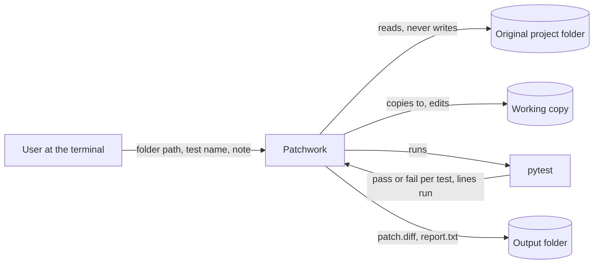
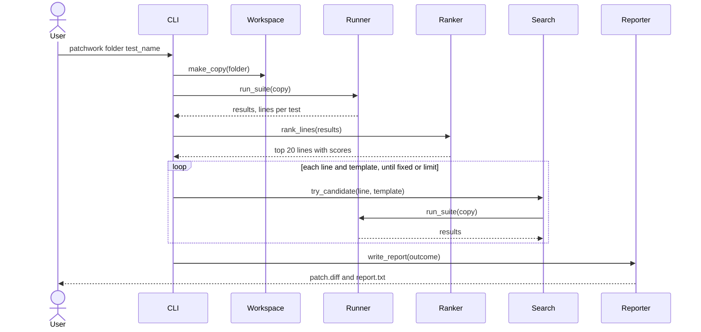
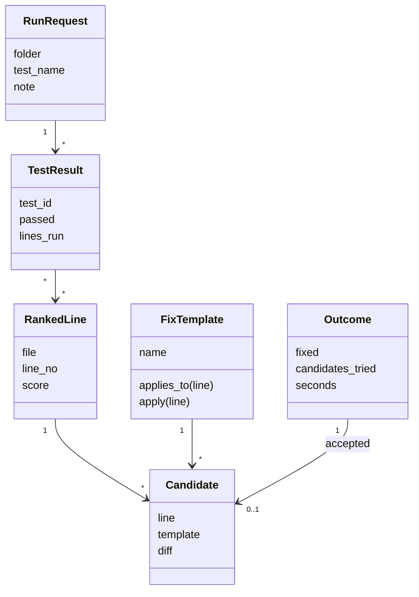
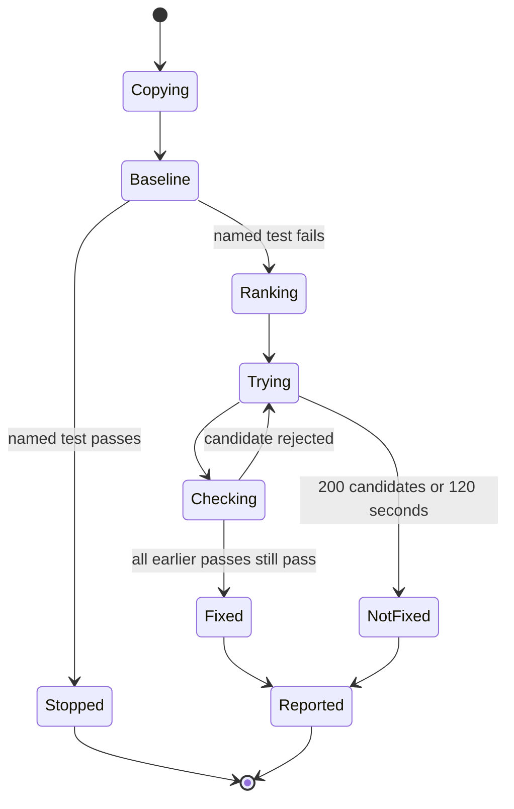

# Full Spec: Patchwork

**Team:** Zaid Sarwar, Bhargav Gondesi, Ishwar Jha  **Date:** Thu Nov 19, 2026  **Committer:** Zaid Sarwar

**Roles:** Product Owner Zaid Sarwar | Process lead Ishwar Jha | Architect Bhargav Gondesi | Quality lead Ishwar Jha | Prompt engineer Zaid Sarwar

---

## 0. The idea (Chapter 1)
- The single main problem, and for whom (one sentence): A student or developer with a small Python project has a test that just started failing and wants a small, checked fix suggested without sending their code to an AI service.
- Who is harmed if this app fails, is wrong, or leaks data? The user, if Patchwork saves a "fix" that makes the named test pass but breaks something no test covers, or if it changes their original files. Anyone who later uses that code is harmed too if the user merges a bad diff without reading it.
- Anything the app must never do (privacy, safety, legal): It must never change the original project folder, never send code or results off the computer, never call an AI model, and never run any command except pytest. It must never present a candidate as "fixed" unless every test that passed before still passes.

## 1. Process and plan (Chapters 2 and 3)  Owner: Ishwar Jha
- Process model we chose (plan-driven, incremental, or agile) and **why it fits this app** (2 sentences): We use an incremental, agile process with three short sprints. Patchwork splits into steps that each work on their own (copy, run tests, rank lines, try templates, report), so every sprint can end with a tool that runs, and the seeded-bug table tells us after each sprint whether the last change helped.
- Practices we actually use: sprints (three), a board (GitHub Issues in the team fork), code review on every pull request, tests on every change (`uv run pytest` must pass before merge), and a short retrospective at the end of each sprint in the team GroupMe. We do not hold daily stand-ups, because we meet in person only on Thursdays; we post a one-line status in GroupMe instead.
- **Definition of Done** (checklist, 4 or more items):
  - [ ] The change has a unit test that fails without it and passes with it.
  - [ ] `uv run pytest` passes on a clean clone.
  - [ ] Every new function has a docstring, and its test checks what the docstring promises.
  - [ ] Another team member reviewed and approved the pull request.
  - [ ] The original sample project folder is unchanged after running the tool (checked by test).
  - [ ] The requirement-to-test map in Section 6 names the new test.
- Sprint plan (what is working at the end of each sprint):

| Sprint | Working software at the end | se-agent run? |
|---|---|---|
| 1 | `patchwork <folder> <test>` copies the project, runs pytest once, stops with a message if the named test passes, and prints the 20 highest Ochiai-ranked lines. Sample project with the first 5 seeded bugs. | Yes, run 1 (cheap model): requirements, models and architecture records from the Run Brief |
| 2 | All six fix templates, the full-suite check after each candidate, the 200-candidate and 120-second limits, and the diff plus report files. Sample project grows to 10 seeded bugs. | Yes, run 2: design, implementation and test records, checked against our code |
| 3 | Evaluation script printing the 10-bug results table, README steps tested on a clean machine, and the demo. Should-do items only if time is left. | Optional run 3, only if run 2 left gaps |

- Biggest schedule risk and what we will do about it: The coverage step (recording which lines each test runs with only the standard library) could take longer than planned. If it is not working by the middle of Sprint 1, we fall back to `sys.settrace` on the copied project only, which is slower but simple, and we keep the 120-second limit.
- AI contribution: Claude (Opus 5.5) drafted this section from our Project Brief. The process choice, the three-sprint length and the Thursday-only meeting constraint come from the team.

## 2. Requirements (Chapter 4)  Owner (Product Owner): Zaid Sarwar
**Stakeholders and what each wants:**

| Stakeholder | Wants |
|---|---|
| Student or developer (end user) | A fix for one failing test in minutes, with a diff they can read before applying it |
| Course instructor (Cliff Whitworth) | A working app built through the Sommerville process, with requirements traced to tests and an honest account of AI use |
| Team (Zaid, Bhargav, Ishwar) | A scope three people can finish before the end of the semester, with each part owned by one person |
| Anyone who later uses the user's code | No silent behavior changes from an unreviewed patch |

**User stories** (as a ___, I want ___, so that ___), each with acceptance criteria:
1. As a student, I want to give Patchwork my project folder and the name of the failing test, so that I do not have to search the code by hand. Acceptance: with the sample project and the test for "average() crashes on an empty list," the tool prints a ranked list of lines with scores.
2. As a student, I want my original folder left alone, so that a bad candidate can never damage my work. Acceptance: a checksum of every file in the original folder is the same before and after a run.
3. As a developer, I want a fix to count only when every test that passed before still passes, so that I do not trade one bug for another. Acceptance: on a seeded bug where a template makes the named test pass but breaks another test, the tool rejects that candidate and keeps searching.
4. As a developer, I want a diff and a short report, so that I can review the change before I apply it. Acceptance: after a successful run, the output folder holds one unified diff file and one report listing the ranked lines, the template used, the candidates tried and the seconds taken.
5. As a student, I want the tool to stop and still tell me what it tried, so that a hard bug does not hang my terminal. Acceptance: on a seeded bug no template covers, the tool stops within 120 seconds or 200 candidates, prints "not fixed," and saves its report.
6. As the team, we want an evaluation script, so that we can show how many seeded bugs the templates fix. Acceptance: the script prints a table with one row per seeded bug: bug ID, fixed or not, template, candidates, seconds.

**Requirements table**

| ID | Type (F = functional, NF = non-functional) | Requirement (one testable sentence) | Priority (Must/Should) | Acceptance test (input -> expected result) |
|---|---|---|---|---|
| R1 | F | The tool takes a project folder path and a pytest test name, plus an optional note of 300 characters or fewer that is copied into the report. | Must | Valid folder, valid test name, 40-character note -> run starts and the note appears in the report; a 301-character note -> error message, nothing runs |
| R2 | F | The tool works on a copy of the project and never writes inside the original folder. | Must | Any run -> checksums of the original folder match before and after |
| R3 | F | The tool runs the suite once and stops with a clear message if the named test does not fail. | Must | Name of a passing test -> message "test does not fail" and exit code 1; no candidates tried |
| R4 | F | The tool records the lines each test runs and scores every line with the Ochiai formula. | Must | Sample project, average() bug -> the line with the division ranks first or second |
| R5 | F | The tool tries six templates (comparison swap, arithmetic swap, bound shift by 1, condition negation, and/or swap, empty-or-None guard) on the 20 highest-ranked lines, one change at a time. | Must | Seeded off-by-one bug -> the bound-shift template produces the accepted candidate |
| R6 | F | A candidate counts as a fix only when the named test passes and every test that passed before still passes. | Must | Candidate that fixes the named test but breaks another -> rejected, search continues |
| R7 | F | The tool saves a unified diff and a report with ranked lines and scores, template used, candidates tried and seconds taken. | Must | Successful run -> output folder holds patch.diff and report.txt with those fields |
| R8 | F | An evaluation script runs the tool on a sample project with 10 seeded bugs and prints a results table. | Must | `uv run python evaluate.py` -> table with 10 rows and five columns |
| R9 | NF (performance) | One run stops after 200 candidates or 120 seconds, whichever comes first, and still saves its report. | Must | Seeded bug no template covers -> finishes in 120 seconds or less with "not fixed" and a saved report |
| R10 | NF (usability) | All output is plain text, readable by a screen reader, and every error message says what to do next. | Must | Missing folder -> one line naming the path and the fix ("check the folder path") |
| R11 | NF (security or privacy) | The tool runs no command except pytest, opens no network connection and never writes outside the copy. | Must | Run with networking disabled -> same result as with networking on; a code search finds one subprocess call, to pytest |
| R12 | NF (cost) | The tool calls no AI model and needs no API key, so each use costs $0. | Must | Run with no `.env` file and no key -> completes normally |
| R13 | NF (reliability) | The same input always gives the same output. | Must | Run the same input twice -> the two diff files are byte-for-byte identical |
| R14 | F | Open a pull request on a new branch instead of only saving a diff. | Should | Not tested this semester |

**Out of scope** (so nobody builds it by accident):
- Languages other than Python; projects with no tests or more than 50 Python files.
- Bugs that need more than one change; more than one failing test per run.
- Writing the failing test for the user.
- A web or chat interface.
- Any AI model at run time.

**Requirements we removed as unnecessary, and why:**
- AI-generated patches. Bhargav's first version was an AI agent. Zaid changed it on Nov 11 to rule-based templates, because an AI call would add cost, a key and output that changes between runs (it would break R12 and R13).
- Growing the sample project from 10 to 15 seeded bugs. Moved to "Should do," because 10 already covers every template and two uncovered cases.

**Open questions** (better listed than guessed):
- How many of the 10 seeded bugs the six templates fix. The evaluation table answers it at the end of Sprint 2.
- TODO: whether the standard-library tracer is fast enough on a 50-file project to stay inside 120 seconds. We will time it in Sprint 1.

**Check:** We replaced "fast" with the 200-candidate and 120-second limits (R9), "secure" with the single pytest command and no network (R11), and "easy to read" with plain text and next-step error messages (R10).
- AI contribution: Claude drafted the stakeholder table, the user stories and the acceptance tests from our brief. The no-AI rule, the limits and the out-of-scope list are the team's (Zaid, Nov 11).

## 3. Models (Chapter 5)  Owner (Architect): Bhargav Gondesi
**Context model** (what is inside the system, what is outside, what crosses the boundary):

Inside the system: the command, the ranking, the templates, the checker and the report writer. Outside: the user, the original folder, pytest and the output folder. Nothing crosses to the network.

**Use cases or a sequence model for the most important story:**

**Class or data model** (main entities and how they relate):

**State model** (only if the app has modes; otherwise write "no modes"):

**Consistency check:** R13 (same input, same output) appeared in no model at first. We resolved it in the sequence model by fixing the order: lines sorted by score, then by file name and line number, and templates always tried in the order listed in R5. The note in RunRequest is needed by R1 and R7 only, so it is not passed to the search.
- AI contribution: Claude drafted the four diagrams from our brief. The team checked that every message in the sequence diagram is an operation in Section 5.

## 4. Architecture (Chapter 6)  Owner (Architect): Bhargav Gondesi
- Pattern we chose (layered, MVC, client-server, pipe-and-filter, other): Pipe and filter. Each step takes the output of the step before it: copy -> baseline run -> rank -> try and check -> report.
- Which non-functional requirements drove it (name the R-numbers): R13 (same input, same output) and R9 (stop at the limit and still report) both need a fixed order of steps with clear handoffs. R2 and R11 are easier to check when only the Workspace filter touches files and only the Runner filter starts a process.
- Alternatives we rejected, and why: Layered, because a command-line tool with no stored data gains little from layers. Client-server, because R11 rules out network use. A repository pattern, because the steps pass small results forward and do not need a shared store.
- **If the app uses an AI model:** Patchwork does not use an AI model (R12). No fallback is needed, and the cost per use is $0.

**Decisions log**

| # | Decision | Alternatives | Reason (tie to an R-number) | Consequence |
|---|---|---|---|---|
| D1 | Rule-based fix templates, no AI at run time | An AI agent that writes patches (Bhargav's first idea) | R12 and R13: $0 per use and the same output every time | Fixes are limited to the six templates; two seeded bugs are expected to stay "not fixed" |
| D2 | Ochiai scoring for line ranking | Tarantula; ranking by recent edits | R4 names Ochiai, and it needs only pass or fail per test and the lines each test ran | Needs line coverage per test, which costs one traced run of the suite |
| D3 | Every candidate is checked by rerunning the full suite | Rerun only the named test | R6: a fix must keep every earlier pass | Slower search, held in check by R9's limits |
| D4 | Work only on a temporary copy | Edit in place and undo with git | R2: the original folder must never change | Disk use doubles for the length of the run (fine at 50 files or fewer) |

- AI contribution: Claude drafted the alternatives and the decisions table. D1 is Zaid's ruling from Nov 11; the Ochiai and seeded-bug ideas are Bhargav's.

## 5. Design and implementation (Chapter 7)  Owner: Bhargav Gondesi
- Modules, and the owner of each:

| Module | Owner | Responsibility |
|---|---|---|
| `cli.py` | Zaid Sarwar | Reads the arguments, checks them (R1, R10), calls the other modules in order, prints the outcome |
| `workspace.py` | Ishwar Jha | Makes the temporary copy and computes folder checksums (R2) |
| `runner.py` | Bhargav Gondesi | Runs pytest on the copy and records pass or fail and lines run per test (R3, R11) |
| `ranker.py` | Bhargav Gondesi | Ochiai score per line and the sorted top 20 (R4, R13) |
| `templates.py` | Bhargav Gondesi | The six fix templates, one function each (R5) |
| `search.py` | Zaid Sarwar | Tries candidates, checks each with the runner, enforces the limits (R6, R9) |
| `report.py` | Ishwar Jha | Writes patch.diff and report.txt (R7) |
| `evaluate.py` and `sample_project/` | Ishwar Jha | The 10 seeded bugs and the results table (R8) |

- Where the logic lives **apart from the display** (so it can be unit-tested): All logic is in the modules above, as small functions with one or two inputs and outputs. Only `cli.py` prints to the terminal, so every other function can be unit-tested without capturing output.
- Design patterns we will use, and where (or "none yet"): Strategy, in `templates.py`: each template has the same two operations (`applies_to(line)` and `apply(line)`), so the search loops over a list of templates and adding one never touches the others.
- Code or libraries we will reuse, with their licenses: Python 3.12 standard library (PSF License: `ast`, `difflib`, `shutil`, `tempfile`, `subprocess`, `sys.settrace`) and pytest (MIT). Patchwork itself is MIT, like se-agent.
- Branching and review rule (for example: pull request, one approval, tests green): One branch per issue, a pull request into main, one approval from another member, and `uv run pytest` green before merge. Nobody pushes straight to main after Sprint 1 starts.
- Technical debt we are knowingly accepting: Coverage through `sys.settrace` is slower than a coverage library; we accept that to keep the standard-library-only constraint. Templates work on one line at a time, so multi-line bugs are out of scope.
- AI contribution: Claude proposed the module split and the Strategy pattern. Module owners are the team's choice.

## 6. Testing (Chapter 8)  Owner (Quality lead): Ishwar Jha
**Requirement-to-test map** (every Must-do needs at least one):

| Requirement | Test (file::name) | Type (unit / component / system / user) | How we will check it can fail |
|---|---|---|---|
| R1 | tests/test_cli.py::test_note_over_300_chars_rejected | unit | Raise the limit to 400 in the code; the test must fail |
| R2 | tests/test_workspace.py::test_original_folder_unchanged | system | Make the search write to the original path once; the checksum test must fail |
| R3 | tests/test_runner.py::test_stops_when_named_test_passes | component | Name a test that fails; the test must fail because candidates start |
| R4 | tests/test_ranker.py::test_ochiai_known_values | unit | Swap the formula's denominator; the hand-computed scores must not match |
| R5 | tests/test_templates.py::test_each_template_one_change | unit | Make one template change two tokens; the one-change assertion must fail |
| R6 | tests/test_search.py::test_rejects_fix_that_breaks_other_test | component | Check only the named test; the seeded case must then wrongly report "fixed" |
| R7 | tests/test_report.py::test_report_fields_present | unit | Remove the seconds field; the test must fail |
| R8 | tests/test_evaluate.py::test_table_has_ten_rows | system | Remove one seeded bug; the row count must fail |
| R9 | tests/test_search.py::test_stops_at_candidate_limit | component | Set the limit to 201; the counter assertion must fail |
| R10 | tests/test_cli.py::test_missing_folder_message | unit | Change the message text; the assertion must fail |
| R11 | tests/test_runner.py::test_only_pytest_is_run | unit | Add a second subprocess call; the mock must record it and fail |
| R12 | tests/test_cli.py::test_runs_without_env_or_key | system | Import an AI client at start; the run must error without a key |
| R13 | tests/test_search.py::test_same_input_same_diff | system | Shuffle tied lines randomly; two runs must give different diffs |

**The three most important tests, in plain language** (input -> expected result):
1. Sample project and the failing test for "average() crashes on an empty list" -> a ranked list, an accepted empty-input guard and a diff where all tests pass.
2. A seeded bug where one template fixes the named test but breaks another -> that candidate is rejected and the report lists it as tried.
3. The same folder and test run twice -> two byte-for-byte identical diff files, and the original folder's checksums unchanged.

- Edge cases we will try to break each Must-do with (zero, negative, empty, huge, missing): an empty note and a note of exactly 300 characters; a missing folder; a folder with no tests; a test name that does not exist; a project of exactly 50 Python files and one of 51; a line ranked with a score of zero; a bug no template covers; a test that takes longer than 120 seconds on its own.
- User testing: one classmate outside the team who uses Python but has not seen Patchwork. They run it on the sample project from the README alone, and we want to learn whether the report tells them what changed and whether they would trust the diff.
- What we are deliberately **not** testing, and why: projects over 50 files and multi-line bugs (out of scope), the pull-request Should-do (not built this semester), and Windows path quirks beyond one manual run on Zaid's PC.
- Test command: `uv run pytest`
- AI contribution: Claude drafted the map and the edge cases. The "how we will check it can fail" column follows Whitworth's in-class rule that every function gets a docstring and a unit test of what the docstring says.

## 7. Evolution (Chapter 9)  Owner: Zaid Sarwar
- The most likely future change: Adding new fix templates once the evaluation table shows which seeded bugs stay "not fixed" (for example, swapping a function's argument order or changing a wrong variable name).
- Impact analysis: modules, models, requirements and tests that would change, and about how long: `templates.py` gets one new function; `search.py`, `ranker.py` and the other modules do not change. R5 changes from six templates to seven, the class model gains nothing new (the template is another FixTemplate), `tests/test_templates.py` gets one test, and the sample project may gain one seeded bug. About two to three hours per template.
- What design choice today would make that change easier: Keeping every template behind the same two operations (Section 5, Strategy pattern) and keeping the template list in one place, so the search never names a template directly.
- AI contribution: Claude drafted the impact analysis. Choosing template growth as the likely change came from the seeded-bug evaluation idea (Bhargav).

## 8. Decisions we are least sure about
(Prepare to be asked about these.)
- Whether `sys.settrace` coverage stays inside 120 seconds on a 50-file project (D2, R9).
- Whether rerunning the full suite for every candidate is too slow with 20 lines times six templates (D3). If it is, we will order templates by how often they fixed seeded bugs, which still keeps R13.
- Whether two uncovered seeded bugs out of 10 is the right share to show the tool's limits honestly.

## 9. Run plan and cost (se-agent)  Owner (Prompt engineer): Zaid Sarwar
- Prompts in `prompts/` we will use, in order: ch02_software_processes, ch03_agile_development, ch04_requirements_engineering, ch05_system_modeling, ch06_architectural_design, ch07_design_implementation, ch08_software_testing, ch09_software_evolution. The router picks the order from each prompt's Role and Task; this is the order we expect. TODO: add an implementer prompt that writes .py files before run 2, because none of the eight writes code files.
- Model (use `gpt-6-luna` for iteration; ask before using a stronger one): gpt-6-luna for every run.
- Planned runs (default: one per sprint):

| Run | Sprint | Prompts | Model | Estimated cost (`uv run python cost_estimate.py docs/RUN_BRIEF.md`) |
|---|---|---|---|---|
| 1 | 1 | The eight prompts above | gpt-6-luna | $0.01 light (4 steps), $0.02 typical (6 steps), $0.04 heavy (8 steps) |
| 2 | 2 | The eight prompts plus the implementer prompt | gpt-6-luna | About $0.02 to $0.05 (estimate to be rerun once the implementer prompt exists) |

- Before we request a run, we confirmed: `uv run pytest` passes / Run Brief is 4,000 characters or fewer / each prompt follows the 8-section template

## 10. Run Brief
The Run Brief is `docs/RUN_BRIEF.md`. It is the Project Brief we submitted on Wed Nov 11 (docs/project_brief.md), copied without changes.

- Characters in our Run Brief: 3,819
- What we cut to fit, and why it was safe to cut: Nothing was cut from the Run Brief itself. This Full Spec holds what the brief leaves out (stakeholders, process, models, the decisions log and the test map), and the agents do not need those to draft the app, because every Must-do, limit and acceptance check they need is already in the brief in words.

## 11. Presentation notes (six beats; every member speaks)
| Beat | Who | One sentence we will say |
|---|---|---|
| 1. Problem, user, Must-dos (Ch 4) | Zaid Sarwar | Patchwork gives a student a reviewed, rule-based fix for one failing Python test in two minutes or less, without sending their code anywhere. |
| 2. Process choice and Definition of Done (Ch 2, 3) | Ishwar Jha | We worked in three sprints, and nothing counted as done until it had a test that could fail and another member's approval. |
| 3. Context model and one more model (Ch 5) | Bhargav Gondesi | The context model shows Patchwork only reads the original folder and only runs pytest, and the state model shows it always ends in a saved report. |
| 4. One architecture decision: chosen, rejected, which requirement forced it (Ch 6) | Bhargav Gondesi | We chose rule-based templates over an AI agent, because R12 and R13 require $0 per use and the same output every time. |
| 5. Three most important tests, and how we know they can fail (Ch 8) | Ishwar Jha | Our key tests prove the original folder never changes, a fix that breaks another test is rejected, and two runs give the same diff, and each one fails when we break that rule on purpose. |
| 6. Likely change, Run Brief, cost plan (Ch 9, 4) | Zaid Sarwar | A new template touches one file and one test, our Run Brief is 3,819 characters, and each se-agent run costs about two cents on gpt-6-luna. |
